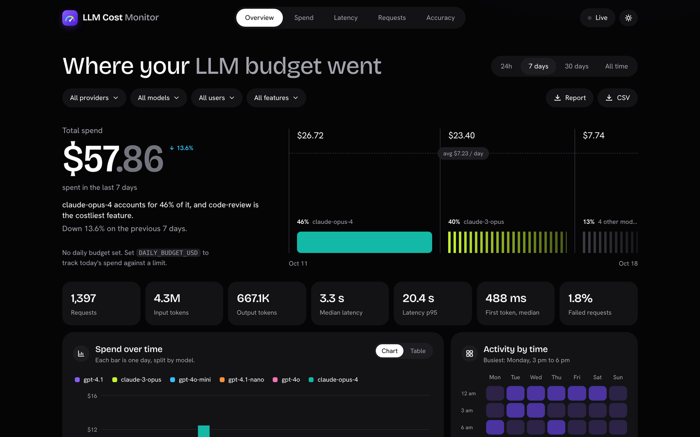
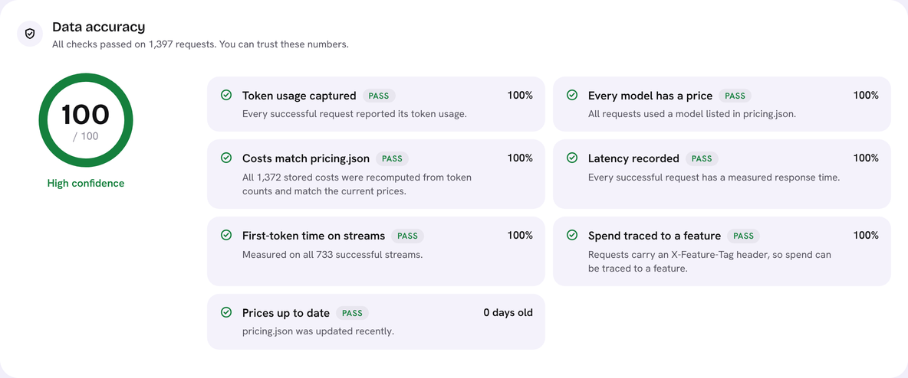

# LLM Cost & Latency Monitor

A tiny logging proxy that sits between your app and the Anthropic / OpenAI APIs and records
**tokens, cost, and latency (including time-to-first-token) for every request**, with a React
dashboard to explore it.

**Adopting it is one line:** change the SDK's base URL. No wrapper library, no code changes.

```
Your app ──▶ Proxy (FastAPI) ──▶ Anthropic / OpenAI
                  │
                  ▼
          SQLite (WAL mode) ──▶ JSON API ──▶ React dashboard (served at /dashboard)
```

One process, one port: the proxy, the API, and the dashboard all run from `uvicorn proxy.main:app`.





<sub>Screenshots show synthetic demo data from `scripts/seed_demo_data.py`.</sub>

## Features

- **Drop-in proxy** for Anthropic (`/v1/messages`) and OpenAI (`/v1/chat/completions`, `/v1/responses`)
- **Streaming done right:** chunks are relayed as they arrive; usage and TTFT are tallied on the side
- **Cost per request** from an editable `pricing.json` (hot-reloaded), including prompt-cache tokens
- **Attribution:** tag requests by user and feature with two headers
- **React dashboard:** a plain-language summary of where the money went, spend over time by model,
  p50/p95/p99 latency, time-to-first-token, spend by user and feature, costliest requests, failures,
  a daily-budget meter, filters, live refresh, light and dark themes, and a table view for every chart
- **Data accuracy score:** seven checks tell you whether to trust the numbers: token usage captured,
  every model priced, stored costs re-computed against `pricing.json`, latency and time-to-first-token
  recorded, spend traced to a feature, and how old your prices are
- **Downloadable reports:** one click exports the current view as a Markdown report (summary, accuracy
  checks, breakdowns, costliest calls) or every request as CSV
- **Budget alerts:** one Slack/Discord webhook per day when spend crosses your limit
- **Never breaks your app:** if logging fails, your response still goes through
- **Private by default:** API keys are forwarded, never stored; prompts are not logged unless you opt in

## Quick start (Python only, no Node needed)

```bash
python -m venv .venv
source .venv/bin/activate            # Windows PowerShell: .venv\Scripts\Activate.ps1
pip install -r requirements.txt

python scripts/seed_demo_data.py     # optional: synthetic demo data, no API keys needed
uvicorn proxy.main:app --port 8000
```

Open **http://localhost:8000/dashboard**.

The built dashboard ships in `proxy/static/`, so you only need Node.js if you want to change the UI.

### Docker

```bash
cp .env.example .env          # optional: set DAILY_BUDGET_USD, SLACK_WEBHOOK_URL
docker compose up --build     # http://localhost:8000/dashboard
docker compose run --rm monitor python scripts/seed_demo_data.py   # optional demo data
```

## Use it from your code

Only the base URL changes. Your real API key still goes in the normal place; the proxy forwards it.

**Anthropic**

```python
import anthropic

client = anthropic.Anthropic(
    base_url="http://localhost:8000/anthropic",
    default_headers={"x-user-tag": "alice", "x-feature-tag": "chat-assistant"},  # optional
)
msg = client.messages.create(model="<your-model>", max_tokens=200,
                             messages=[{"role": "user", "content": "Hello"}])
```

**OpenAI**

```python
from openai import OpenAI

client = OpenAI(
    base_url="http://localhost:8000/openai/v1",
    default_headers={"x-user-tag": "alice", "x-feature-tag": "chat-assistant"},  # optional
)
```

**curl**

```bash
curl http://localhost:8000/anthropic/v1/messages \
  -H "x-api-key: $ANTHROPIC_API_KEY" -H "anthropic-version: 2023-06-01" \
  -H "content-type: application/json" -H "x-feature-tag: demo" \
  -d '{"model":"<your-model>","max_tokens":64,"messages":[{"role":"user","content":"hi"}]}'
```

Bare-URL aliases (`http://localhost:8000/v1/messages`, `/v1/chat/completions`, `/v1/responses`) also work.

## Set your prices (important)

`pricing.json` holds USD per **million** tokens and matches models by longest prefix
(`gpt-4o-mini-2024-07-18` → `gpt-4o-mini`). The file ships with **example rates for older models**.
Prices change, so check each provider's pricing page and add the models you actually use.

```json
"your-model-name": { "input": 3.00, "output": 15.00, "cache_read": 0.30, "cache_write": 3.75 }
```

If a request uses a model with no entry, it is logged with cost $0 **and flagged**; the dashboard
shows a banner listing the unpriced models so you never silently under-count spend.
Edits to the file apply without restarting the proxy.

## Configuration

| Variable | Default | Purpose |
|---|---|---|
| `DB_PATH` | `data/monitor.db` | SQLite file (Docker uses a volume at `/data`) |
| `PRICING_PATH` | `pricing.json` | Price table |
| `DAILY_BUDGET_USD` | *(off)* | Alert when today's (UTC) spend crosses this; also drives the dashboard meter |
| `SLACK_WEBHOOK_URL` | *(off)* | Slack or Discord incoming webhook for alerts |
| `LOG_PROMPTS` | `0` | `1` stores a 2,000-char prompt preview per request |
| `INJECT_OPENAI_USAGE` | `1` | Adds `stream_options.include_usage` to OpenAI streamed chat requests |
| `ANTHROPIC_BASE_URL` / `OPENAI_BASE_URL` | official APIs | Point at a gateway or compatible endpoint |
| `REQUEST_TIMEOUT_S` | `300` | Upstream read timeout |

On Windows PowerShell, set variables for one session with `$env:DAILY_BUDGET_USD="50"` before starting the proxy,
or put them in `.env` and run `uvicorn proxy.main:app --env-file .env`.

## Demo it for real

```bash
export ANTHROPIC_API_KEY=...              # and/or OPENAI_API_KEY
export DEMO_ANTHROPIC_MODEL=<a cheap model you have access to>
python scripts/demo_traffic.py --n 50     # 50 tiny calls (about cents) through the proxy
```

Keep the dashboard open with **Live** switched on while it runs. That is your screen recording.

## How it works

1. The proxy receives the request, forwards it with your original headers (minus the two tag headers), and times it.
2. **Non-streaming:** it reads `usage` from the JSON response.
3. **Streaming:** it relays SSE chunks untouched while a parser reads usage on the side:
   Anthropic reports input tokens in `message_start` and output tokens in `message_delta`;
   OpenAI reports usage in a final chunk (the proxy asks for it) or in `response.completed`.
   TTFT is the time to the first *content* delta, not the first byte.
4. Cache tokens are normalised: Anthropic reports them separately from input, OpenAI reports them as a
   subset of the prompt, so the proxy subtracts to keep one cost formula.
5. A row is written after the response completes (also on errors and client disconnects).
6. The dashboard calls `GET /api/dashboard` (range, timezone and filters as query parameters). The
   server aggregates in one pass and returns everything the page needs in a single response.

7. The accuracy checks run over the same rows, so the score always describes the view you are looking at.
   `GET /api/report?format=md|csv` takes the same query parameters and returns the view as a file.

Not logged: `count_tokens` calls (free) and non-JSON requests such as file uploads.

## Changing the dashboard

The UI is a Vite + React + TypeScript app using Recharts, in `web/`. You need Node.js 20+.

```bash
cd web
npm install
npm run dev        # http://localhost:5173/dashboard/ with hot reload; needs the proxy running on :8000
npm run build      # type-checks, then writes the production build into proxy/static/
```

## Project layout

```
proxy/        FastAPI proxy, usage parsing, pricing, SQLite, budget alerts, dashboard API
proxy/static/ the built React dashboard (generated by `npm run build`)
web/          React + TypeScript source for the dashboard
scripts/      seed_demo_data.py (synthetic), demo_traffic.py (real calls)
tests/        proxy, parser, pricing, dashboard-API, accuracy and report tests
docs/         design notes and a LinkedIn post kit
```

Run the tests: `pytest`

## Limits and next steps

- **No authentication.** Anyone who can reach the proxy can use it (with their own key) and read the dashboard.
  Docker binds to localhost only; add auth and TLS before exposing it anywhere.
- SQLite is perfect for one instance. For several proxy replicas or heavy volume, move to Postgres.
- The dashboard API loads the selected time range into memory to compute percentiles; for tens of millions
  of rows you would want pre-aggregated tables.
- Latency is measured at the proxy, so it includes the proxy-to-provider hop but not your app-to-proxy hop.
- Ideas: per-user budgets, a model router, a semantic cache, Gemini / Bedrock adapters.
