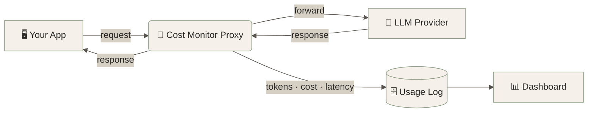

<!-- ═══════════════════════════ HEADER ═══════════════════════════ -->
<p align="center">
  
</p>

<p align="center">
  <b>A lightweight logging proxy + live dashboard that shows exactly what your LLM calls cost and how fast they are.</b>
</p>

<p align="center">
  
  
  
  
</p>

<p align="center">
  <a href="#-features">Features</a> •
  <a href="#-how-it-works">How it works</a> •
  <a href="#-quick-start">Quick start</a> •
  <a href="#-dashboard">Dashboard</a> •
  <a href="#-roadmap">Roadmap</a> •
  <a href="#-contributing">Contributing</a>
</p>


## 🧭 Why this exists

LLM bills grow quietly. A prompt gets longer, a model gets swapped, a retry loop runs twice, and nobody notices until the invoice arrives.

**LLM Cost Monitor** sits between your app and the model provider. It logs every request with zero changes to your app logic, then turns those logs into a dashboard you can read in five seconds.

> [!TIP]
> Point your app's base URL at the proxy and you're done. No SDK rewrite, no vendor lock-in.


## ✨ Features

<table>
  <tr>
    <td width="50%" valign="top">
      <h3>💸 Cost tracking</h3>
      Per-request cost calculated from input and output tokens using each model's pricing. See totals by day, model, or endpoint.
    </td>
    <td width="50%" valign="top">
      <h3>⏱️ Latency monitoring</h3>
      Response time for every call, with averages and slow-request spotting so you know which model or prompt is dragging.
    </td>
  </tr>
  <tr>
    <td width="50%" valign="top">
      <h3>🔌 Drop-in proxy</h3>
      Forwards requests to the provider unchanged and logs the metadata on the way back. Your app keeps working exactly as before.
    </td>
    <td width="50%" valign="top">
      <h3>📊 Live dashboard</h3>
      Clean, neutral-toned charts and tables for spend, token usage, and latency trends, readable at a glance.
    </td>
  </tr>
  <tr>
    <td width="50%" valign="top">
      <h3>🧾 Request log</h3>
      Searchable history of every call: model, tokens in/out, cost, latency, and status.
    </td>
    <td width="50%" valign="top">
      <h3>🪶 Lightweight</h3>
      Minimal setup, local storage, no heavy infrastructure. Runs on a laptop.
    </td>
  </tr>
</table>


## 🏗️ How it works



| Step | What happens |
|:---:|:---|
| **1** | Your app sends its normal LLM request to the proxy instead of the provider |
| **2** | The proxy forwards it and starts a timer |
| **3** | On response, it reads token usage and computes cost from the model's price table |
| **4** | Metadata is saved to the usage log; the response goes back to your app untouched |
| **5** | The dashboard reads the log and renders spend, usage, and latency |


## 🚀 Quick start

```bash
# 1. Clone
git clone https://github.com/Hafsa-Anwar65/<REPO-NAME>.git
cd <REPO-NAME>

# 2. Install dependencies
pip install -r requirements.txt

# 3. Add your provider key
cp .env.example .env
#   then set your API key inside .env

# 4. Run the proxy + dashboard
<YOUR-RUN-COMMAND>
```

Then point your app at the proxy:

```python
client = OpenAI(base_url="http://localhost:<PORT>/v1", api_key="your-key")
```


## 📊 Dashboard

<p align="center">
  
</p>

<p align="center"><i>Spend, token usage, and latency in one view.</i></p>


## 🧰 Tech stack

<p align="center">
  
  
  
  
</p>


## 🗺️ Roadmap

- [x] Logging proxy with token + latency capture
- [x] Cost calculation per request
- [x] Dashboard with spend and latency views
- [ ] Support for more providers (Anthropic, Gemini, Groq, local models)
- [ ] Budget limits with alerts
- [ ] Per-project / per-API-key cost breakdown
- [ ] CSV export of usage logs
- [ ] Docker image for one-command setup


## 🤝 Contributing

Contributions are very welcome, especially during **Hacktoberfest** 🎃

1. **Fork** the repo and create a branch: `git checkout -b feature/your-idea`
2. **Make your change** and keep it focused on one thing
3. **Commit** with a clear message: `git commit -m "Add budget alert threshold"`
4. **Open a PR** describing what you changed and why

> [!NOTE]
> New here? Look for issues labelled **`good first issue`**. Adding a model's pricing to the price table is a great first PR.


## 👩‍💻 Author

<p align="center">
  <b>Hafsa Anwar</b><br/>
  <sub>AI &amp; Automation Engineer</sub><br/><br/>
  <a href="https://www.linkedin.com/in/hafsa-anwar-53b251313"></a>
  <a href="https://github.com/Hafsa-Anwar65"></a>
</p>

<p align="center"><sub>If this project saved you money, a ⭐ helps others find it.</sub></p>

<!-- ═══════════════════════════ FOOTER ═══════════════════════════ -->
<p align="center">
  
</p>
