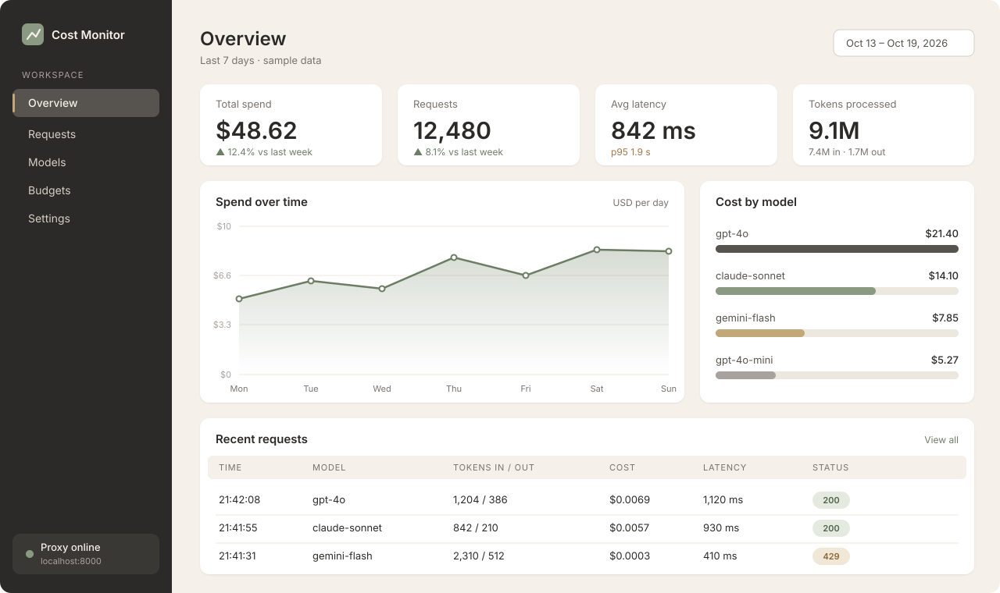
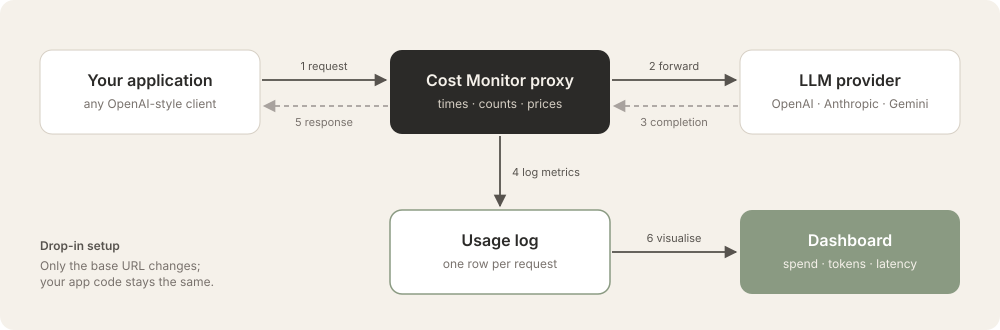

<div align="center">


<br/>


<p>
<a href="#overview">Overview</a> &nbsp;·&nbsp;
<a href="#interface">Interface</a> &nbsp;·&nbsp;
<a href="#how-it-works">How it works</a> &nbsp;·&nbsp;
<a href="#getting-started">Getting started</a> &nbsp;·&nbsp;
<a href="#roadmap">Roadmap</a> &nbsp;·&nbsp;
<a href="#contributing">Contributing</a>
</p>

</div>

---

## Overview

LLM costs are easy to lose track of. Prompts get longer, models get swapped, and retries run in the background. Usually nobody notices until the invoice arrives.

**LLM Cost Monitor** is a lightweight logging proxy that sits between your application and the model provider. It records the token usage, cost and latency of every request, and a dashboard turns those records into numbers you can act on.

| | |
|:--|:--|
| **What it is** | A drop-in proxy plus a dashboard |
| **Who it is for** | Developers and teams running LLM features in production or prototypes |
| **What you change** | One line: your client's base URL |
| **What you get** | Per-request cost, latency, and token usage, aggregated by model and over time |

---

## Interface

<p align="center">
  
</p>
<p align="center"><sub>Dashboard overview (illustrative sample data)</sub></p>

The dashboard has three areas:

| Area | What it shows |
|:--|:--|
| **Summary cards** | Total spend, request count, average and p95 latency, and tokens processed for the selected period |
| **Spend over time / Cost by model** | Daily cost trend, plus which models drive the bill |
| **Recent requests** | A live log with model, input and output tokens, cost, latency and HTTP status for each call |

---

## How it works

<p align="center">
  
</p>

1. **Request:** your application sends a normal chat or completion request to the proxy instead of the provider.
2. **Forward:** the proxy starts a timer and forwards the request unchanged.
3. **Completion:** the provider responds with the output and its token usage.
4. **Log:** the proxy calculates cost from the model's price table and writes one record to the usage log.
5. **Response:** the original response is returned to your application, untouched.
6. **Visualise:** the dashboard reads the usage log and aggregates it.

### What gets recorded

| Field | Description |
|:--|:--|
| `timestamp` | When the request was made |
| `model` | Model name reported by the provider |
| `input_tokens` / `output_tokens` | Token counts from the provider's usage field |
| `cost_usd` | Calculated from the model's per-token pricing |
| `latency_ms` | Time from request sent to response received |
| `status` | HTTP status code of the provider response |

---

## Features

| Feature | Description |
|:--|:--|
| **Cost tracking** | Per-request and aggregate cost, broken down by day and by model |
| **Latency monitoring** | Average and p95 latency to spot slow models or prompts |
| **Token accounting** | Separate input and output token totals |
| **Drop-in proxy** | No SDK changes and no code rewrites; only the base URL changes |
| **Request history** | A searchable log of every call, including failures such as rate limits |
| **Local first** | Runs on your machine with lightweight local storage |

---

## Getting started

### Prerequisites

- Python 3.10 or newer
- An API key for at least one LLM provider

### Installation

```bash
git clone https://github.com/Hafsa-Anwar65/<REPO-NAME>.git
cd <REPO-NAME>
pip install -r requirements.txt
cp .env.example .env
```

### Configuration

| Variable | Required | Description |
|:--|:--:|:--|
| `OPENAI_API_KEY` | Yes | Provider API key forwarded with requests |
| `PROXY_PORT` | No | Port the proxy listens on (default `8000`) |
| `DB_PATH` | No | Location of the usage log database |

### Run

```bash
<YOUR-RUN-COMMAND>
```

### Connect your application

Point your existing client at the proxy. Nothing else changes.

```python
from openai import OpenAI

client = OpenAI(
    base_url="http://localhost:8000/v1",
    api_key="your-api-key",
)

response = client.chat.completions.create(
    model="gpt-4o-mini",
    messages=[{"role": "user", "content": "Hello"}],
)
```

Open the dashboard at `http://localhost:<DASHBOARD-PORT>` to see the request appear.

---

## Tech stack

<p>


</p>

---

## Roadmap

- [x] Logging proxy with token and latency capture
- [x] Per-request cost calculation
- [x] Dashboard with spend, model and latency views
- [ ] Additional providers: Anthropic, Gemini, Groq, local models
- [ ] Budget thresholds with alerts
- [ ] Cost breakdown per project and per API key
- [ ] CSV export of usage logs
- [ ] Docker image for one-command setup

---

## Contributing

Contributions are welcome, and this repository takes part in **Hacktoberfest**.

1. Fork the repository and create a branch: `git checkout -b feature/short-description`
2. Keep each pull request focused on a single change
3. Write a clear commit message, for example `Add pricing for gemini-1.5-pro`
4. Open a pull request that explains what changed and why

> [!NOTE]
> New to the project? Issues labelled `good first issue` are a good place to start. Adding a model to the pricing table is a small, self-contained first contribution.

---

## License

Distributed under the MIT License. See [`LICENSE`](LICENSE) for details.

---

<div align="center">

**Hafsa Anwar** · AI & Automation Engineer

<a href="https://www.linkedin.com/in/hafsa-anwar-53b251313"></a>
<a href="https://github.com/Hafsa-Anwar65"></a>

<sub>If this project is useful to you, consider giving it a star.</sub>

</div>
